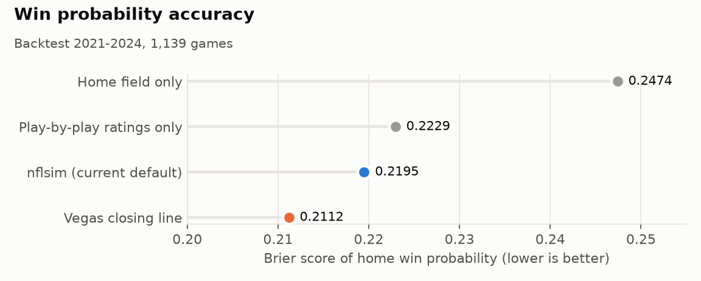
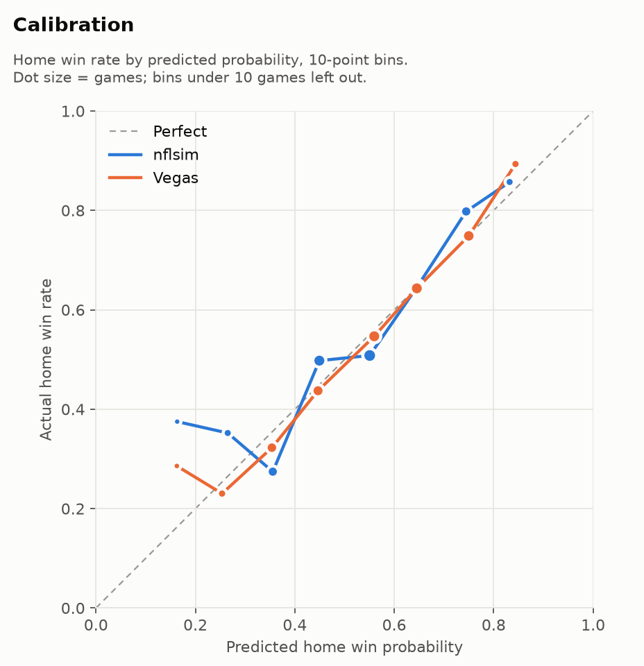
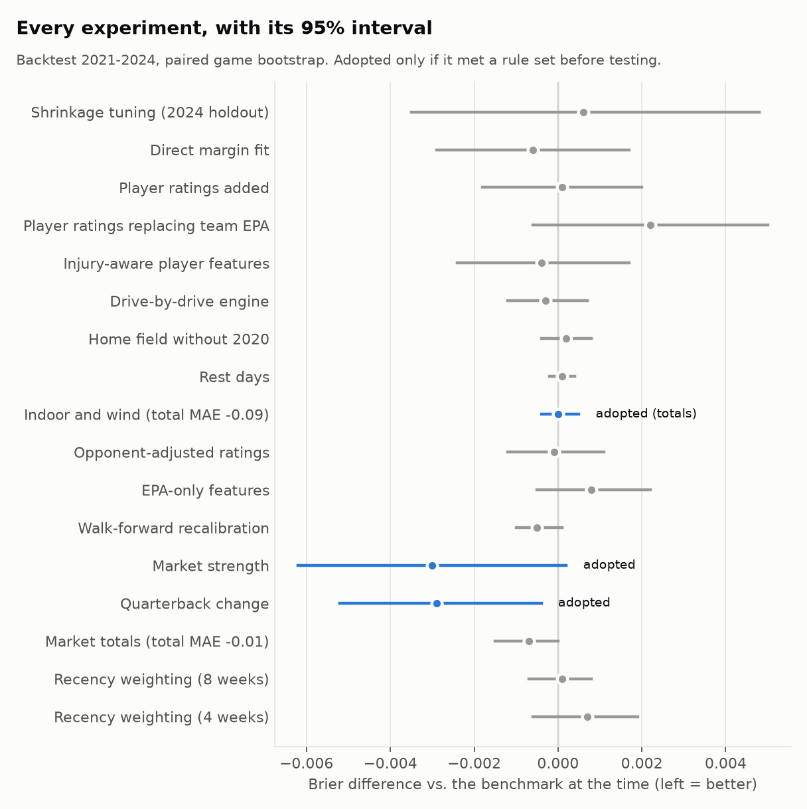

# nflsim

[](https://github.com/FrancisHoang/nflsim/actions/workflows/ci.yml)

A Monte Carlo NFL game simulator. Given two teams and a week, it simulates the game many
times and reports win probability, score distributions, spread, total and player stat
lines. It uses play-by-play team ratings, player ratings, injury reports for both rosters,
weather and earlier weeks' betting markets, all as of kickoff.



**At a glance**

- **Honest evaluation.** A walk-forward backtest over 1,139 games (2021-2024): each season
  is predicted from a model fit only on earlier seasons, with ratings built only from games
  before kickoff. Margin MAE 10.06 vs. 9.79 for the Vegas closing line; Brier 0.2195 vs.
  0.2112.
- **Every idea is tested against a rule set before running it.** 17 experiments, 3
  adopted. The rest (player ratings, injury-aware lineups, matchups, a drive-by-drive
  engine, rest, recency weighting...) are built, documented and opt-in, with the numbers
  that kept them out. [The full record](#what-was-tested).
- **Calibrated, not just accurate.** Win probabilities track actual win rates (see
  [calibration](#calibration)); scores are full distributions, scored with CRPS, cover
  and over chances and key-number frequencies.
- **Reproducible.** Every simulation takes an explicit seed; every tunable number lives in
  a config file; tests never touch the network. Python 3.11+, polars, strict mypy, CI on
  every pull request.

NFL outcomes are high-variance. The goal is a **well-calibrated** model, not certainty.

## How it works

1. **Data.** [nflverse](https://github.com/nflverse) play-by-play, schedules, rosters,
   injury reports, depth charts and snap counts, cached as parquet.
2. **Ratings, as of week W.** Team offense and defense (EPA per play, success rate, pace)
   from the season's games before W, shrunk toward the league average and last season
   (empirical Bayes). Market strength from earlier weeks' closing spreads. The starting
   quarterback's rating against the quarterbacks the team ratings were built on.
3. **Points model.** A regression of each team's points on those features, refit each
   season on the five seasons before it.
4. **Simulation.** Each team's score is drawn from a negative binomial around its expected
   points, 10,000 times. With injury-aware settings, who plays is drawn per run from the
   injury report, and backups move up the depth chart at their own ratings.
5. **Output.** Win probability, score and margin quantiles, cover and over chances
   against any line, per-player stat lines with ranges, and flags wherever data was
   missing and a coarser estimate was used.

## Example

`nflsim week` simulates every game of a week (here 2025 week 12, already played, so the
final score is shown; kickoff column cut here):

```
$ uv run nflsim week --season 2025 --week 12 --n 10000 --seed 42
     game  home win      model      vegas  home covers  total  vegas total   over  final
---------  --------  ---------  ---------  -----------  -----  -----------  -----  -----
BUF @ HOU     30.4%   HOU +6.8   HOU +5.5        47.0%   47.7         43.5  59.4%  23-19
 IND @ KC     59.4%    KC -3.4    KC -3.5        49.2%   52.0         50.5  50.3%  23-20
 MIN @ GB     85.0%   GB -12.4    GB -6.5        67.1%   42.4         41.5  48.8%   23-6
 NE @ CIN     47.3%   CIN +0.9   CIN +7.5        69.1%   49.8         50.5  44.0%  20-26
NYG @ DET     85.4%  DET -14.4  DET -14.0        47.4%   49.1         50.5  42.7%  34-27
  ...
```

`nflsim simulate` goes deeper on one game: score quantiles, per-player stat lines, a
"What I used" block (ratings date, listed starters, the injury report for both teams) and
what-ifs such as `--out "Patrick Mahomes" --compare`.

## Install

Requires [uv](https://docs.astral.sh/uv/). uv installs Python 3.11+ and all dependencies
into a project-local `.venv`:

```sh
git clone https://github.com/FrancisHoang/nflsim.git
cd nflsim
uv sync
```

## Data

All data comes from [nflverse](https://github.com/nflverse) via
[nflreadpy](https://github.com/nflverse/nflreadpy) and is cached as parquet under `data/`
(gitignored), one file per dataset per season:

```
data/pbp/season=2024.parquet
data/injuries/season=2024.parquet
data/players.parquet
```

```sh
uv run nflsim datasets                                    # list available datasets
uv run nflsim fetch                                       # everything, 2016 to now
uv run nflsim fetch --seasons 2023-2024 --datasets pbp,schedules
uv run nflsim fetch --seasons 2024 --refresh              # force re-download
```

Completed seasons are downloaded once and never refetched. Files for the current season
are refetched once they are older than `current_season_max_age_hours` (12 by default).
Seasons before a dataset's first available year are skipped with a message.

From Python:

```python
from nflsim.config import load_settings
from nflsim.data import DataCache

cache = DataCache(load_settings().data)
pbp = cache.load("pbp", [2023, 2024])  # polars DataFrame
```

See [docs/data.md](docs/data.md) for the dataset list and known gaps.

## Usage

```sh
# Simulate one game from ratings as of the given week (stats through the week before)
uv run nflsim simulate --home KC --away BUF --season 2025 --week 12 --n 10000 --seed 42
#   --spread -3.5 --total 47.5   cover/over chances (default: the schedule's lines)
#   --out "Name" --compare       what-if: a player out, with and without
#   --players                    per-player stat lines with ranges
#   --json                       everything as JSON

# Every game of a week in one table (model vs. Vegas line, cover and over chances)
uv run nflsim week --season 2026 --week 11

# Walk-forward backtest: fit on earlier seasons, predict each test season
uv run nflsim backtest --seasons 2021-2024 --n 10000 --seed 42
```

### Dashboard

```sh
uv sync --extra dashboard
uv run nflsim dashboard            # opens http://localhost:8501
```

A Streamlit front end over the same functions as the CLI, so it shows the same numbers
for the same seed. It reads the local data cache and never downloads (run `nflsim fetch`
first).

- **Week:** every game of a week with the model next to the Vegas line, the winners
  picked once games are played, a model-vs-Vegas line chart, and the flags and data
  behind the predictions (`nflsim week`).
- **Game:** one game in depth (`nflsim simulate`): win chances, the distribution of final
  margins against the Vegas line, score ranges, cover and over chances (also against your
  own line), what-ifs (rule a player out or make him doubtful, compared with the same
  seed), players who may not play, and per-player stat lines.
- **How good is it:** the walk-forward backtest (every method on the same games, by
  season, calibration against Vegas) and every experiment with its 95% interval. It reads
  saved predictions from `data/backtest/`; make one with
  `uv run nflsim backtest --seasons 2021-2024 --n 10000 --seed 42 --output data/backtest/default_2021-2024.parquet`.

Every simulation takes an explicit seed. To use player ratings and injury reports, pass a
config with the player features and `injury_aware = true` under `[model]`; `simulate`
then draws who plays in each run and lists players on the injury report who may not
play. The CLAUDE.md command list covers the evaluation tools (`tune`, `player-eval`,
`injury-eval`, `matchup-eval`, `drive-eval`, `stat-eval`, `player-coverage`).

## Results

`nflsim backtest --seasons 2021-2024 --n 10000 --seed 42`, 1,139 games, every game
predicted from information available before kickoff:

| Method | Margin MAE | Total MAE | Brier | Log loss |
|---|---|---|---|---|
| **nflsim (current default)** | **10.06** | **10.44** | **0.2195** | **0.6307** |
| nflsim without market inputs (`pbp_only`) | 10.14 | 10.46 | 0.2229 | 0.6381 |
| Phase 1 baseline (team ratings only) | 10.17 | 10.69 | 0.2254 | 0.6437 |
| Vegas closing line | 9.79 | 10.29 | 0.2112 | 0.6115 |
| Home field only | 11.00 | 10.90 | 0.2474 | 0.6893 |

Vegas is still better, by about a quarter of a point of margin MAE and 0.008 Brier. The
closing line knows things this model does not: this week's injury news, weather at
kickoff, and the market's read of each matchup.

Two inputs use earlier weeks' Vegas lines (market strength, below), so the backtest also
reports `pbp_only`, the same model without them, as an independent measure of the
play-by-play ratings.

### Calibration



Both track the diagonal from 35% to 85%. Below 30% the model is off: in the 98 games
where it gave the home team under 30% (23% on average), home teams won 35%. Vegas's
under-30% games (105, 23% on average) won 24%. Actual vs. predicted margin
slope is 0.93 (1.00 = calibrated; the Phase 1 baseline was 1.20, under-confident).

### What was tested



Each change was compared with the model it would replace on the same games (paired game
bootstrap), against an adoption rule written down before the run. The record is
[docs/experiments.csv](docs/experiments.csv); each experiment has a write-up in `docs/`.

What worked was **information the model did not have**:

- **Market strength** (`mkt`, `opp_mkt`): each team's strength implied by the closing
  spreads of *earlier* weeks, shrunk toward last season. Brier -0.0030 (95% CI [-0.0062,
  +0.0002], better in 3 of 4 seasons; -0.0042 on 2017-2024, CI [-0.0068, -0.0015]). It
  also fixed most of the under-confidence (slope 1.20 -> 0.92).
  [docs/underconfidence.md](docs/underconfidence.md)
- **Quarterback change** (`qb_change`): this week's starter's rating minus the rating of
  the quarterbacks the team ratings were built on. Most of the remaining gap to Vegas was
  late-season games with a backup quarterback. Brier -0.0029 (95% CI [-0.0052, -0.0004]).
  The starter is the one nflverse lists, which for past games is the actual starter, so
  this backtest is slightly optimistic. [docs/qb-change.md](docs/qb-change.md)
- **Indoor and wind**: total MAE -0.09 (3 of 4 seasons). Wind lowers the total by about
  4 points per 10 mph. [docs/phase6-plan.md](docs/phase6-plan.md)

What did not: **reshaping what the model already knew.** Player-level ratings, injury-
aware lineups, pass-rush matchups, a drive-by-drive engine, opponent adjustment, rest,
home-field variants, recalibration, recency weighting and market totals all landed
within noise of the benchmark. Shrinkage already balances signal and noise in the team
ratings, and the team ratings already reflect the players who have been playing. These
stay in the code as opt-in options, with their results in
[`default_config.toml`](src/nflsim/default_config.toml) next to each setting.

To redraw the figures:

```sh
uv run nflsim backtest --seasons 2021-2024 --n 10000 --seed 42 --output preds.parquet
uv run --group docs python scripts/make_figures.py preds.parquet
```

## Configuration

Every tunable number lives in a TOML config file, never in code. The defaults are in
[`src/nflsim/default_config.toml`](src/nflsim/default_config.toml). To change them, copy
that file and pass `--config my_config.toml`. Unknown keys or out-of-range values are
rejected.

## Development

```sh
uv run pytest            # tests (never touch the network)
uv run ruff check .      # lint
uv run ruff format .     # format
uv run mypy              # strict type checking
```

CI runs all four on Python 3.11 and 3.12 for every push and pull request. See
[CONTRIBUTING.md](CONTRIBUTING.md) for branch and commit conventions.

## Roadmap

| Phase | Feature | Status |
|---|---|---|
| 0 | Scaffold, CI, cached data loaders | ✅ |
| 1 | Baseline team-rating sim with shrinkage and a backtest harness (the benchmark) | ✅ |
| 2 | Player-level ratings | ✅ (opt-in; no backtest gain) |
| 3 | Injuries for both rosters, sampled per simulation | ✅ (opt-in; no significant backtest gain) |
| 4 | Position-group and individual matchups | ⛔ stopped: pass-rush matchup tested, no gain ([plan and results](docs/phase4-plan.md)) |
| 5 | Tendencies, game script, drive/play-level engine | ⛔ drive engine built (opt-in), no gain at its gate; game script not built ([plan and results](docs/phase5-plan.md)) |
| 6 | Context: home field, rest, travel, weather, coaching | ✅ indoor + wind by default; home field and rest no gain ([plan and results](docs/phase6-plan.md)) |
| 7 | Scenarios ("QB1 out"), CLI output, market strength, quarterback change, dashboard | in progress: CLI and scenarios done; dashboard next |

## License

[MIT](LICENSE). nflverse data is subject to its own licensing and is never committed to
this repository.
